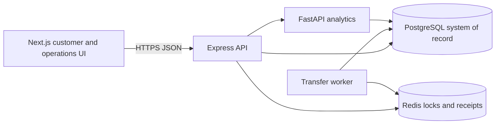
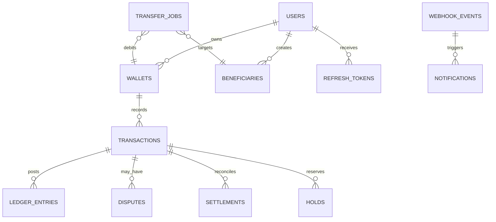

# FinCore Architecture

## Service and data flow

Express owns users, accounts, wallets, beneficiaries, transactions, ledger entries,
holds, settlements, disputes, notifications, and webhook records. FastAPI reads
financial data for calculations and risk decision support. Redis stores ephemeral
locks and idempotency receipts. The worker owns transfer-job execution and writes
the resulting transaction and ledger records through the same consistency engine.

## Core entity relationships

All monetary amounts use PostgreSQL `NUMERIC(18,4)`. Ledger entries are append-only,
and new completed transactions are required to have balanced debit and credit rows.
